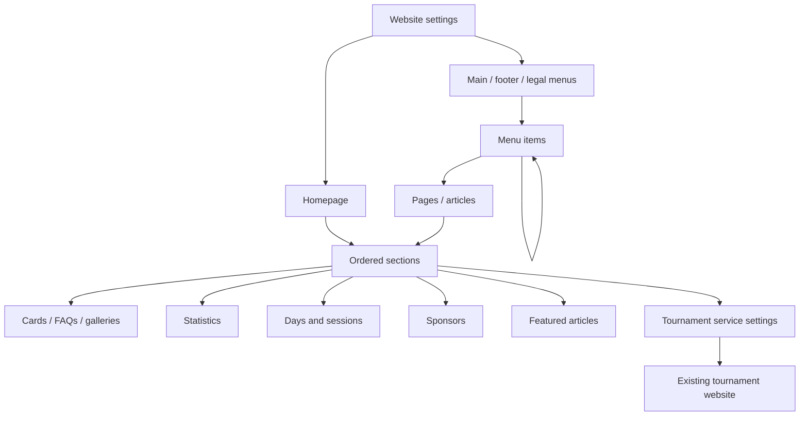

# HBCC Contentful editor guide

The website now uses structured entries, native rich text, media pickers and ordered references. Ordinary editing needs no HTML or JSON. The package contains **13 content types, 290 entries and 96 assets**.

**Account status:** the actual Contentful space is empty at the latest check. Delivery and Preview keys work; creating these models and entries requires a Management token. Local review uses the same structured model from a preserved fixture until import is complete.

## Content model

| Type | What editors manage |
| --- | --- |
| Website settings (`siteSettings`) | Club name, logo, favicon, contact/address, homepage, main/footer/legal menus, header/footer social links, join banner, footer gallery, copyright and news labels |
| Website page (`page`) | Title, slug, summary/SEO, hero, ordered sections, homepage partner/buttons/features, visibility and search indexing |
| Menu (`navigationMenu`) | Named menu or footer column; items in display order |
| Menu item / button / social link (`navigationItem`) | Label, page reference or URL, nested children, new-tab behavior, icon and visibility |
| Page / homepage section (`section`) | Layout, headings, rich text, image, actions and linked collections |
| Card / question / timeline item (`contentCard`) | Features, information cards, FAQ questions/answers and dated timeline entries |
| Club statistic (`statistic`) | Display value, label, icon and visibility |
| Weekly schedule day (`scheduleDay`) | Day, ordered sessions and no-session message |
| Weekly session (`scheduleSession`) | Session name, display time, venue and optional link |
| Sponsor / partner (`sponsor`) | Name, logo, website, description and visibility |
| Gallery image (`galleryImage`) | Media, alternative text and optional link |
| News article (`post`) | Title, slug, date, rich text, cover/alt, author, category, summary and visibility |
| Tournament integration (`tournamentFeed`) | Expected year, existing service URLs, row/card counts, point label, explanation and timestamp wording |

Sections support rich text, columns, cards, accordions, galleries, approved embeds, statistics, standings/events, feature banners, schedules, sponsors, news, testimonials and join banners. Reuse a section on several pages. The developer controls typography and responsive layout; editors control the content and order.

Every field has a native control: rich text, media/entry picker, ordered entry list, dropdown, slug, number/date input or labelled visibility toggle. Help text explains references, collections and scoring.



## Edit pages

1. In Contentful's Content tab, filter by **Website page** and open the page.
2. Change its title, summary, hero or search title. Replace images with the media picker.
3. Open a linked entry in **Sections in display order**. Use the rich text toolbar for headings, links, lists, tables and embedded images.
4. Drag sections to reorder them. Remove a reference to remove it from this page, or set **Show on website** to Hide to disable the section everywhere it is used.
5. Add a Section entry for another block. Columns link to child sections. FAQs link to Card entries with FAQ presentation, or embed them in rich text.
6. Review drafts, then publish changed entries and their linked media.

New enabled pages appear at the next build without a source-code route. Preserve existing slugs during migration: page references follow a slug edit, but inbound addresses still require redirects. The homepage is selected in Website settings and uses the Homepage template. News and several system routes are reserved.

The Home page has dedicated hero, partner, buttons and feature-card fields. Seven ordered section references manage the rest of the homepage. Website settings manage the shared footer.

## Manage menus

1. Open **Main navigation**, **Club**, **Quick Links** or **Legal links** under Menu.
2. Drag linked items into order or add a Menu item.
3. Enter its label and select a website page. Use URL for external destinations, `/news/`, mail links or anchors. For shared tournament links, select Tournament service and its destination; they follow the service's URL settings. A page reference takes priority, followed by a tournament destination, then URL.
4. Link child items for submenus. Tournaments retains Upcoming & Register → its event links, and Champions → its two history pages.
5. Choose new-tab behavior and visibility; preview and publish the changed item and menu.

Reuse items in several menus or as buttons. Avoid linking an item into its own descendants. Missing published references, recursive cycles and duplicate routes fail clearly instead of creating broken links.

## Tournament data

Tournament administration stays on the [existing site](https://tournament.hobsonsbaychess.com/v2/upcoming) and [repository](https://github.com/Hobsons-Bay-Chess-Club-AU/tournaments). There is no duplicate Event model to maintain.

**2026 Standings** uses the [Open leaderboard](https://tournament.hobsonsbaychess.com/v2/leaderboard/open). Points sum standard/classical tournament scores; rapid/blitz scores are excluded. The first eight positions match the source, including its order for ties. This replaces the single 2025 Club Championship table.

The JSON carries its year and generation timestamp. A year mismatch is rejected; the homepage shows the actual update date, **5 October 2026** at capture. Results and event cards refresh in the browser from public tournament endpoints, without CMS credentials. A verified dated snapshot also supports static rendering and service outages.

Contentful manages surrounding headings, explanations, counts and links. It does not manage scores, registration or event dates. Changing the expected year requires corresponding source data; it does not relabel old results.

Calendar navigation, the weekly schedule action and the retained `/calendar/` page lead to [the existing calendar](https://tournament.hobsonsbaychess.com/v2/calendar). Specific event registration remains on the existing portal.

## Import and preview

Run from `C:\dev\hbcc\dev\website-2027`. Keep the existing read keys in `.env` and add `CONTENTFUL_MANAGEMENT_TOKEN` there. Do not commit or paste credentials.

```powershell
npm run contentful:import                 # Validate counts; no writes
npm run contentful:import -- --apply       # Create models/editors and import drafts
npm run contentful:verify                 # Verify the complete draft graph
npm run cms:preview                       # http://127.0.0.1:4328/
```

The importer stages model IDs before applying cross-type validations, processes preserved media, then creates entries. It detects the default locale, uses stable IDs, retries rate limits and records `contentful/import-report.json`. Reruns skip existing content and do not overwrite editor changes or incompatible models.

Models are activated; assets and entries remain drafts by default. Optional `--apply --publish` publishes the batch after all entries exist. Review imported demo news and historical information first.

After publication:

```powershell
npm run contentful:verify -- --published
npm run build:production
npm run verify
```

Production uses published Delivery content and refuses an empty/incomplete CMS. Static builds cannot include Preview drafts. Ordinary local review uses port 4327; strict draft preview uses port 4328. Stop the ordinary dev server before starting the strict CMS preview.

## Publishing to hosting

The main site is static Astro. A Contentful publish updates the CMS immediately; page copy, new routes, menus and media reach the site after rebuilding/deploying. Reload local CMS preview to see saved drafts.

GitHub Pages is prepared in the [frontend repository](https://github.com/Hobsons-Bay-Chess-Club-AU/website-2027). The repository's private visibility on GitHub Free currently prevents Pages hosting. Once resolved, Actions builds from the published Delivery API and deploys `dist`. Publish linked records as well as the page; a failed build preserves the previous deployment.

After initial Contentful import/publication, enable `CONTENTFUL_REBUILD_ENABLED` for hourly rebuilds, or use **Actions → Build and deploy HBCC → Run workflow** for immediate updates. An authenticated publish/unpublish webhook bridge can be added later. See [GITHUB-PAGES.md](GITHUB-PAGES.md) for setup and the difference between a reference preview and the actual CMS deployment.

Tournament scores and upcoming cards refresh directly from the existing public service, so they do not require a CMS publication or main-site rebuild.

## Content still needing club review

- Five WordPress news stories are football theme demos. They are preserved and flagged **Imported content needs review**; replace or hide them.
- `99 Juniors in 2025` is historical; no unverified 2026 count was invented.
- Membership fees, sponsor tiers, committee names and policies/downloads retain captured wording.
- Contact Form 7 is not a portable mail backend. The contact route uses a functional email link.
- The source schedule PDF was missing; the new links use the tournament calendar.

See [the homepage audit](HOMEPAGE-AUDIT.md), [migration plan](MIGRATION-PLAN.md) and `reference/audit/page-conversion-report.json`.

The model uses Contentful's [native editor interfaces](https://www.contentful.com/developers/docs/extensibility/app-framework/editor-interfaces/) and [rich text format](https://www.contentful.com/developers/docs/tutorials/general/getting-started-with-rich-text-field-type/).
